# PDF de pedido/orçamento comercial

O modelo físico fornecido na conversa foi transformado em um formulário A4 funcional: cabeçalho da empresa, seleção Pedido/Orçamento, dados compactos do cliente, tabela gradeada de quatro colunas, marca d'água e assinatura/total na última folha. Dados e logo vêm exclusivamente da empresa autorizada.

## Referência e comparativo

A [análise anterior à implementação](ANALISE.md) registra as diferenças. A fotografia original foi inspecionada e preservada somente no workspace em `docs/referencias/formulario-fisico.png`: contém contatos reais e está ignorada pelo Git. Nenhum nome, telefone, perfil ou logo da fotografia foi fixado no produto ou nas amostras publicadas. A identificação da gráfica foi omitida por não ser informação da empresa emitente.

| Fotografia                                          | Implementação digital                                                    |
| --------------------------------------------------- | ------------------------------------------------------------------------ |
| Logo à esquerda e identidade concentrada no topo    | Cabeçalho delimitado; campos opcionais omitidos e altura ajustada        |
| Caixas Pedido/Orçamento                             | Tipo persistido, caixa correspondente marcada; independente da situação  |
| Data e campos em linhas compactas                   | Data brasileira e linhas com número, telefone, CPF/CNPJ e IE             |
| Quantidade estreita, descrição ampla, preço e total | Quatro colunas 8/59/14,5/18,5%, valores à direita e unidades preservadas |
| Logo clara no centro da grade                       | Imagem proporcional com opacidade 0,14, somente quando há logo           |
| Assinatura à esquerda e total em caixa à direita    | Rodapé final separado; subtotal/desconto quando aplicáveis               |

A composição foi ajustada à referência frontal: cabeçalho horizontal com contatos/redes em blocos, slogan serifado, data junto à seleção, rótulos seguidos de sublinhados, moldura preta única do cliente à grade, watermark maior e caixa cinza do total. A logo e os dados continuam dinâmicos. A revisão final também validou a impressão da atividade e de todas as linhas de observações extensas.

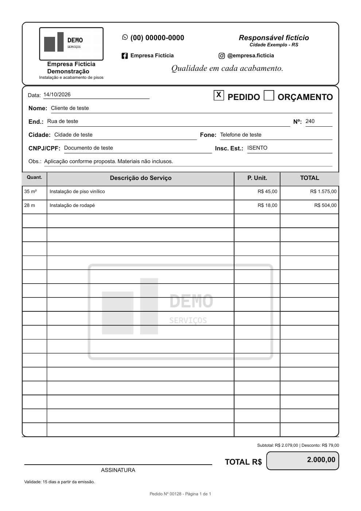

## Campos e persistência

Empresa: `descricaoAtividade`, `nomeResponsavel`, `cidade`, `estado`, `instagram`, `facebook` e `slogan`, todos opcionais. Cliente: `clienteNumeroEndereco` e `clienteInscricaoEstadual`, opcionais, reutilizando nome/endereço/cidade/telefone/documento/observações já existentes. Documento: `tipoDocumento` ORCAMENTO/PEDIDO e `dataEmissao` date-only. Não houve alteração de cálculos ou situações operacionais.

A migration `20261015010000_identidade_comercial_documento` adiciona 11 colunas e um enum, sem DROP, reset, exclusão ou reescrita de registros. Prisma Validate/Generate aprovados. Foi aplicada em `public` e no schema de fixtures após conferir runtime/conexão direta contra o desenvolvimento previamente confirmado pelo usuário. RLS, FKs e isolamento permaneceram ativos.

Novos documentos recebem o dia civil de São Paulo quando a API omite emissão. Datas fornecidas são validadas como dias reais, gravadas em DATE e formatadas sem deslocamento de fuso. Registros anteriores mantêm emissão nula e usam o dia original de `dataCriacao` em São Paulo; não houve backfill. Edição preserva data, tipo e novos campos quando omitidos pela API. Endereços legados não são analisados ou divididos automaticamente.

Configurações agrupa identidade e redes opcionais; criação/edição inclui tipo, emissão, número e IE. Validação Zod compartilhada, mensagens inline, foco e AlertDialog mantidos. Download distingue `pedido-N.pdf` de `orcamento-N.pdf`; abrir, baixar, compartilhar, estado ocupado e trava contra cliques duplicados foram preservados.

## Geração e paginação

O endpoint privado continua usando `@react-pdf/renderer` em Node. O componente consome valores monetários persistidos e apenas os formata. Não recalcula subtotal/total nem recebe caminhos ou URLs de logo do navegador. Os serviços verificam autenticação/assinatura e filtram por empresa; a logo é lida pelo armazenamento privado autorizado. Respostas PDF são `private, no-store`, com MIME PDF e `nosniff`; falhas técnicas são sanitizadas.

O planejador mede quebras com os avanços padrão de Helvetica, considerando descrição, quantidade/unidade e preços. Cada página é A4, com área reservada para rodapé. Itens que cabem numa folha permanecem inteiros; quando não há espaço, seguem para a próxima. Somente itens realmente maiores que uma página continuam em outra, identificados como continuação, sem repetir quantidade/preços. Cabeçalho da tabela, número e identificação se repetem. Assinatura, total e desconto aparecem somente no final.

Observações antecedem a tabela e podem ocupar páginas de continuação quando extensas. Poucos itens deixam linhas vazias na grade existente, sem adicionar folhas para preenchimento. Quebras visuais entre palavras não removem conteúdo; palavras sem espaços também são divididas sem perda. Campos vazios da empresa não produzem rótulos; campos vazios do cliente conservam as linhas do formulário físico.

## Testes e revisão

193 testes unitários e 13 administrativos aprovados; lint, typecheck, formato e build de produção aprovados. Integração HTTP real verificou login, tenant/CSRF, cálculos, CRUD, sequência concorrente, paginação 201, logo privada, PDF e suspensão. Teste PostgreSQL confirmou os novos campos, DATE e RLS em transação revertida.

QA independente: sete grupos E2E aprovados, incluindo pedido com emissão 29/02/2024, número/IE, edição histórica, download com um GET no duplo clique, falha de PDF com AlertDialog, tenant 404, CSRF 403 e UF inválida sem PUT. Cinco larguras 360/390/768/1024/1440 sem overflow ou violações axe nas regras selecionadas; zero erros de página. A configuração foi preenchida somente no navegador para capturas, sem alterar a empresa. A revisão final reutilizou o mesmo documento fictício.

Não existe Designer configurado. O responsável realizou revisão editorial estruturada diretamente contra a fotografia; QA revisou amostras independentemente, sem se apresentar como Designer. Corrigidos: dimensão A4, reservas de linha, unidades longas, fragmentação desnecessária de serviços e cabeçalho vazio excessivo. Suspeitas de contraste durante fade e de divisória numa renderização intermediária foram verificadas no estado final, sem excluir regras. [Parecer QA](QA.md).

Todas as76 páginas das sete amostras passaram na inspeção estrutural: A4, texto dentro da folha, nenhuma folha vazia e rodapé final exclusivo. O caso adversarial confirmou500 caracteres sem espaços,250 linhas de descrição e4000 caracteres de observações preservados. Inspeção visual humana por amostragem de primeiras/intermediárias/últimas páginas confirmou bordas, tipografia, alinhamento, logo, watermark e rodapé; não equivale a examinar visualmente cada folha.

```powershell
npm run lint
npm run typecheck
npm run test:run
npm run test:admin
npm run build
npm exec prisma -- validate
node testes/documento-comercial-banco.mjs
node --import tsx testes/api-integracao.mjs
node testes/pdf-comercial-ui.mjs
node testes/pdf-comercial-ui.mjs --revisao
node testes/pdf-comercial-ui.mjs --capturas
node --import tsx testes/verificar-pdf.tsx --evidencias
python testes/renderizar-pdf-comercial.py CAMINHO_DO_PDFTOPPM
python testes/verificar-pdf-comercial.py
```

E2E requer o servidor de fixtures autorizado na porta3001; preparação não é repetida por esses testes. Python requer pypdf/pdfplumber e Poppler, disponíveis no runtime usado nesta sessão. `--revisao` reutiliza o documento criado; `--capturas` não grava dados e verifica o PDF real. Nenhuma conta Auth nova ou exclusão foi executada. Migrations em outro ambiente requerem confirmar desenvolvimento antes de executar o comando protegido existente.

## Amostras reais

| PDF fictício                                                      | Páginas | Cobertura                                                     |
| ----------------------------------------------------------------- | ------- | ------------------------------------------------------------- |
| [Pedido completo](exemplos/pedido-completo-logo.pdf)              | 1       | Identidade completa, logo, watermark, IE e número             |
| [Simples sem logo](exemplos/orcamento-simples-sem-logo.pdf)       | 1       | Um item, opcionais ausentes e sem watermark                   |
| [Vários itens com logo](exemplos/orcamento-varios-itens-logo.pdf) | 1       | 12itens e quantidades decimais                                |
| [Registro antigo](exemplos/orcamento-teste.pdf)                   | 1       | Fallback de tipo/data e desconto fixo                         |
| [Cem itens curtos](exemplos/orcamento-cem-itens-curtos.pdf)       | 6       | Cabeçalhos repetidos e total final                            |
| [Cem descrições extensas](exemplos/orcamento-extenso.pdf)         | 18      | 500 caracteres/item e desconto percentual                     |
| [Quebras extremas](exemplos/orcamento-quebras-extremas.pdf)       | 48      | Observações 4000, palavras sem espaços e item maior que folha |

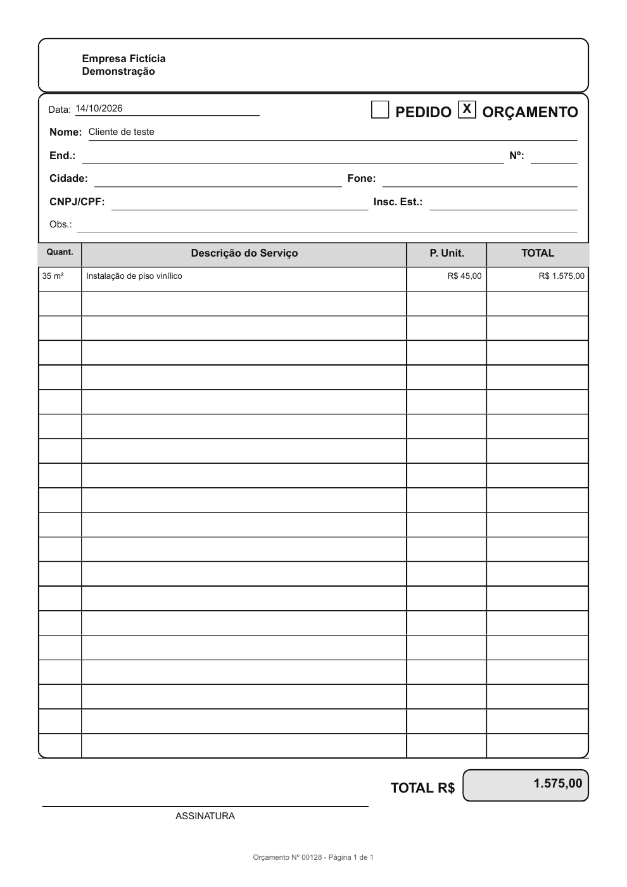
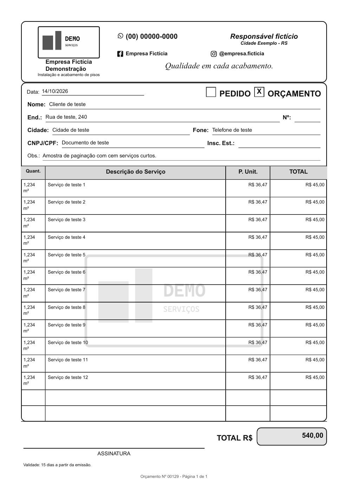
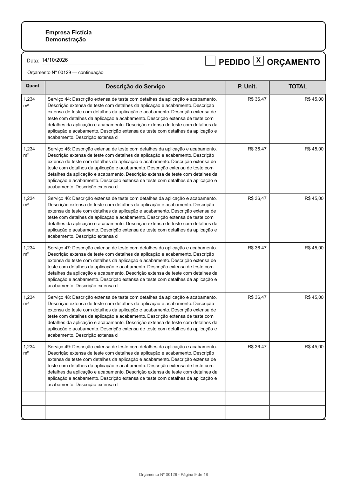
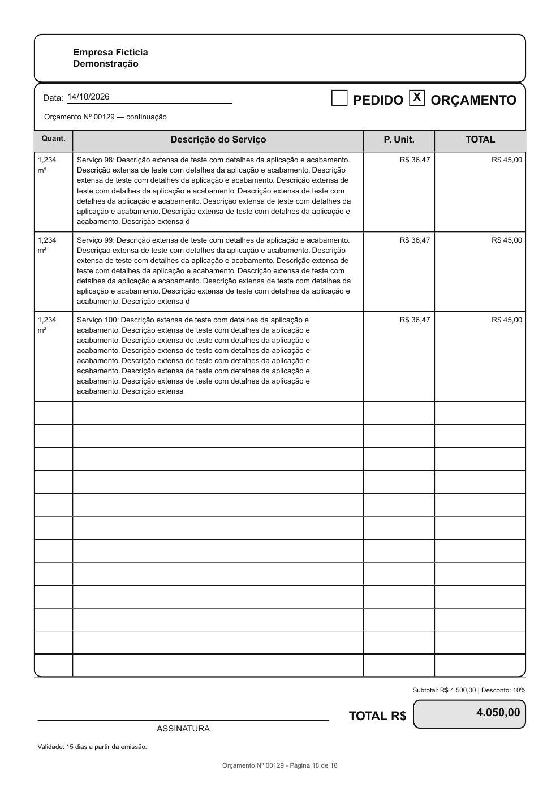
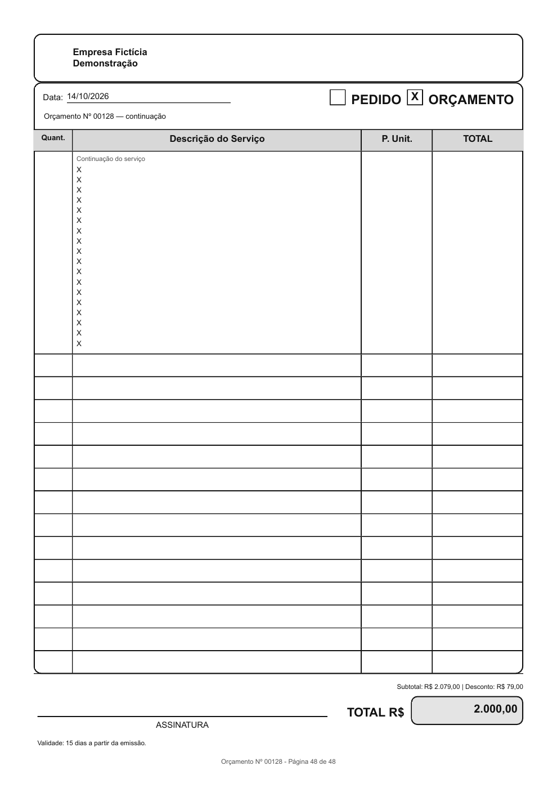

## Telas modificadas

Capturas reais em viewports390×844 e1440×900, de página inteira para mostrar os novos campos.

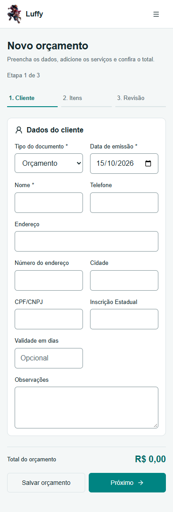

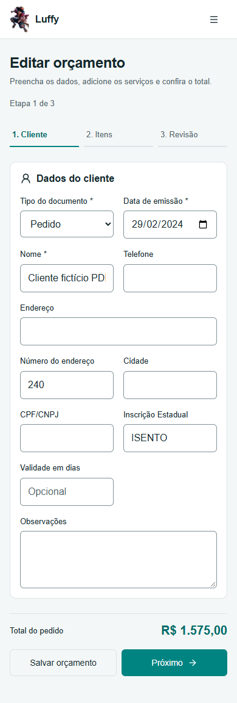
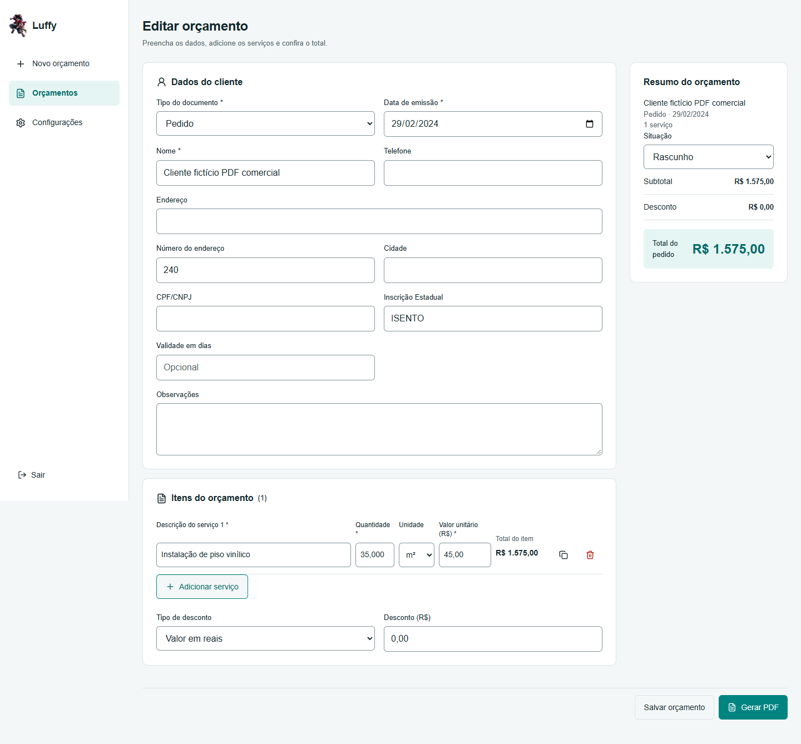
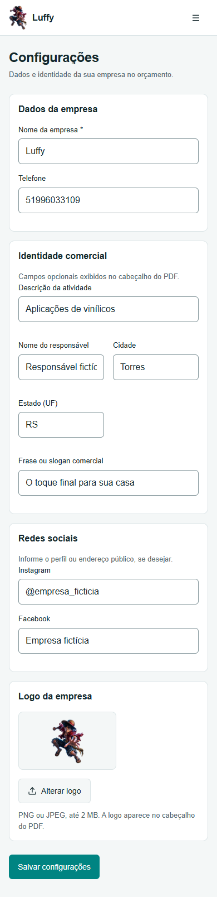
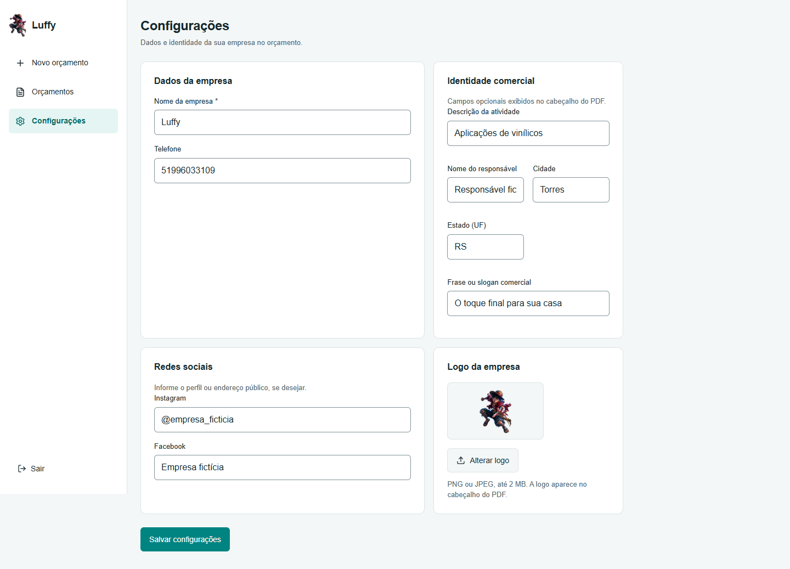

## Limitações

Impressão física, leitor de tela e teclado virtual em aparelho não testados. Helvetica atende os textos pt-BR das amostras; fontes e símbolos fora desse repertório não foram validados. Campos extremos podem gerar documentos longos; não há truncamento para forçar uma folha. O tipo Pedido identifica o documento, sem introduzir estoque, pagamento ou workflow de pedidos. Dados comerciais da empresa são os atuais no momento da geração; snapshot de identidade não fazia parte do modelo nem desta tarefa. Cadastro público no painel Supabase continua sendo a pendência externa registrada anteriormente. Nenhum merge automático ou migration destrutiva realizado.
