# Reformulação UI/UX

A interface foi reformulada sobre o MVP existente para reduzir rolagem e tornar erros, carregamento e ações mais previsíveis. A identidade verde-petróleo, a marca por empresa e a referência visual original foram preservadas. Não foram alterados schema, regras monetárias, Supabase Auth, autorização multiempresa ou armazenamento.

## Auditoria e decisões

A [auditoria inicial](AUDITORIA.md) precedeu as alterações. Prioridades: erros sem campo/foco, edição vazia após falha de GET, loading infinito, confirmação inline sem foco, prévia monetária dependente do nome, serviços altos no desktop e alvos menores que44px.

A direção e os tokens estão em [DESIGN.md](../DESIGN.md): ferramenta operacional compacta para prestadores de serviços que orçam pelo celular. Branco/petróleo, escala4/8/12/16/24/32, controles44px e números tabulares. Utilizamos a skill stop-design-slop para análise e especificação, adaptando suas sugestões à identidade e ao escopo do produto. Não foram introduzidos texturas, marketing, catálogo ou estilos decorativos.

| Área          | Mudança                                                                                   | Motivo                                                |
| ------------- | ----------------------------------------------------------------------------------------- | ----------------------------------------------------- |
| Navegação     | Cabeçalho mobile64px e menu modal com foco/fechamento; seção ativa em detalhes/edição     | Liberar espaço para o trabalho e orientar a navegação |
| Novo/edição   | Cards compactos mobile, linhas editáveis desktop, duplicação local e resumo compartilhado | Reduzir rolagem e conferir valores rapidamente        |
| Salvamento    | Trava síncrona, estado salvando, toast e preservação dos dados após falha                 | Evitar pedidos duplicados e retrabalho                |
| Erros         | AlertDialog shadcn/Radix, mensagens pt-BR e campos ligados por aria-describedby           | Explicar como corrigir e devolver o foco              |
| Carga         | Skeletons reais, retry e estados de erro distintos de vazio/loading                       | Impedir edição de orçamento não carregado             |
| Configurações | Seções de dados/logo, preview compacto e seleção validada                                 | Tornar claro o que será salvo                         |
| Detalhes      | Subtotal/desconto/total e confirmação modal de exclusão                                   | Conferir valores e evitar ações acidentais            |

O resumo monetário usa os mesmos cálculos BigInt do servidor, independente de nome/descrição durante o preenchimento. Campos textuais continuam obrigatórios no salvamento. A API mantém `{erro}` e acrescenta `campos` somente quando há validação estruturada: extensão necessária para o requisito de mensagens servidor/campo, sem alterar status, payloads válidos ou autorização.

## Componentes

`feedback.tsx`: PageHeader, CampoFormulario, LoadingButton, ErrorAlertDialog, ConfirmActionDialog, EmptyState, EstadoErro e PageSkeleton. Primitives personalizados em `ui/alert-dialog.tsx`, `ui/skeleton.tsx` e Button. `item-orcamento-editor.tsx` e `resumo-orcamento.tsx` separam edição/estimativa. `file-upload.tsx` usa infraestrutura privada existente. `notificacoes.tsx` integra Sonner. O App Router usa `loading.tsx` como fallback de navegação; a autenticação no layout foi preservada.

A logo persistida não tem operação de remoção no contrato atual. O botão Remover seleção descarta somente um arquivo ainda não enviado. Não foi criado endpoint ou exclusão remota para esse redesign. Nome/telefone não recebem máscaras rígidas que eliminem formatos existentes; inputMode/tel favorece teclado móvel e valores monetários aceitam vírgula/ponto conforme conversor existente.

## Responsividade e interação

Mobile: uma coluna e etapas Cliente/Itens/Revisão; menu acessível; resumo compacto. Desktop>=1024: navegação lateral e serviços em colunas alinhadas. Resumo lateral sticky somente>=1280, quando existe largura suficiente. Ações permanecem no fluxo para não encobrir inputs ou teclado; a primeira versão com footer sticky foi corrigida após revisão.

Transições150/200ms para feedback e abertura de diálogo, sem espera artificial nas páginas. Entrada modal usa opacity; loading usa indicadores discretos. `prefers-reduced-motion` desativa animações/transições. Contraste dos tokens é calculado em testes; foco2px, alvos44px, nomes acessíveis, erros junto aos campos e diálogos com foco contido/restaurado.

Pontos externos usados como referência: [AlertDialog shadcn/ui](https://ui.shadcn.com/docs/components/radix/alert-dialog), [WCAG2.2: foco não encoberto](https://www.w3.org/WAI/WCAG22/Understanding/focus-not-obscured-minimum), [WCAG2.2: tamanho de alvo](https://www.w3.org/WAI/WCAG22/Understanding/target-size-minimum). Os44px são a meta explícita do produto. Axe/teclado não equivalem a uma certificação WCAG integral.

## Validação

```powershell
npm run test:run
npm run test:admin
npm run lint
npm run typecheck
npm run build
node --import tsx testes/api-integracao.mjs
node testes/ui-redesign.mjs
```

O servidor de testes é iniciado por `node testes/servidor-supabase.mjs --producao --background`, na porta3001, com schema exclusivo existente e sem chave administrativa no processo. Fixtures verificam a impressão digital do alvo; testes não criam novas identidades, aplicam migrations ou excluem dados. Dados/PNG usados são fictícios. `.env`, senhas e arquivos de acesso não são versionados.

Resultados:150 testes unitários e13 administrativos aprovados; lint, typecheck e build aprovados. Integração real da API validou tenant/CSRF, gravação/valores, sequência, paginação201registros, logo/PDF e suspensão. A rodada consolidada de UI passou em cinco viewports, sem overflow, violações axe nas regras selecionadas ou erros de página. Foco após AlertDialog, marca44px, alinhamento, ações sem sobreposição e contraste do toast foram corrigidos e revistos. O callback de foco é preservado antes de o pai apagar o estado do erro.

## Revisão visual e QA

Não existe agente Designer configurado. O responsável executa a revisão visual estruturada prevista como alternativa; ela não é apresentada como revisão independente de Designer. O agente QA faz duas revisões independentes de testes/usabilidade/acessibilidade. [Parecer e evidências](QA.md).

Critérios de revisão visual: identidade consistente, hierarquia total/ações, densidade dos serviços, espaço para conteúdo mobile, legibilidade, estados coerentes, diálogos opacos no estado final e controle de foco. Capturas são produzidas do build real; testes aguardam o fim das animações finitas antes de fotografar. Skeleton é capturado segurando apenas um GET no navegador de teste, simulando rede lenta, sem delay no produto.

Parecer visual estruturado do responsável: aprovado para o escopo, após as correções abaixo.

| Critério     | Evidência e decisão                                                                   |
| ------------ | ------------------------------------------------------------------------------------- |
| Identidade   | Petróleo/branco, marca dinâmica e bordas suaves consistentes com o protótipo          |
| Hierarquia   | Total e ações destacam-se sem disputar espaço com os dados                            |
| Densidade    | Campos em grade e itens em linha no desktop; etapas e cards compactos no celular      |
| Legibilidade | Rótulos associados, texto de input16px no mobile, contraste de notificações corrigido |
| Estados      | Skeleton, erro com retry e vazio são distintos; diálogos opacos e foco restaurado     |
| Conteúdo     | Fotos reais, registros fictícios filtrados e nenhum segredo exposto                   |

Limitações: teclado virtual e leitor de tela em aparelho físico não testados; instalação/compartilhamento nativo dependem de dispositivo compatível. Supabase ainda exige desativar cadastro público no painel; contas sem vínculo não acessam empresas. Os oito alertas altos transitivos já existentes no npm audit permanecem; não usamos upgrades incompatíveis. Não foi realizado merge.

## Capturas reais

Mobile390x844; desktop1440x900; somente fixtures. Capturas da compilação validada; listagem filtrada para registros fictícios.

### Novo orçamento

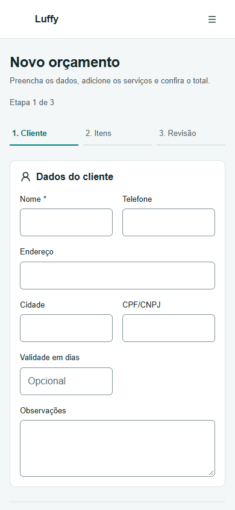
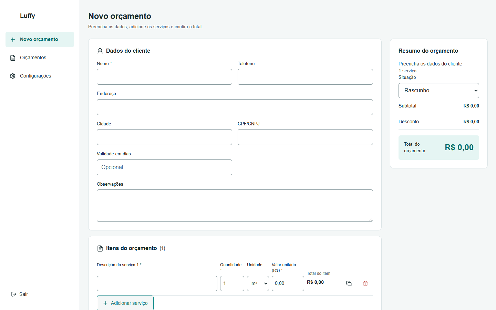

### Listagem

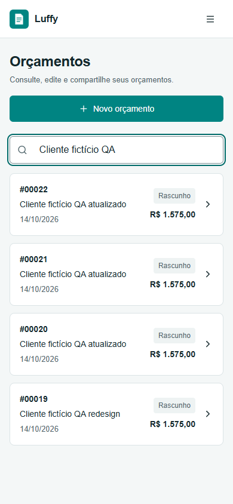
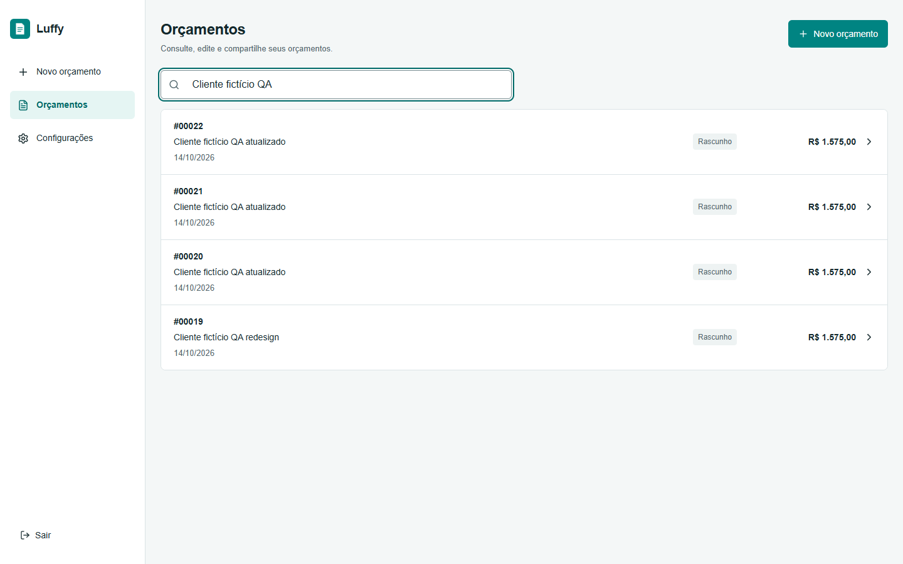

### Configurações

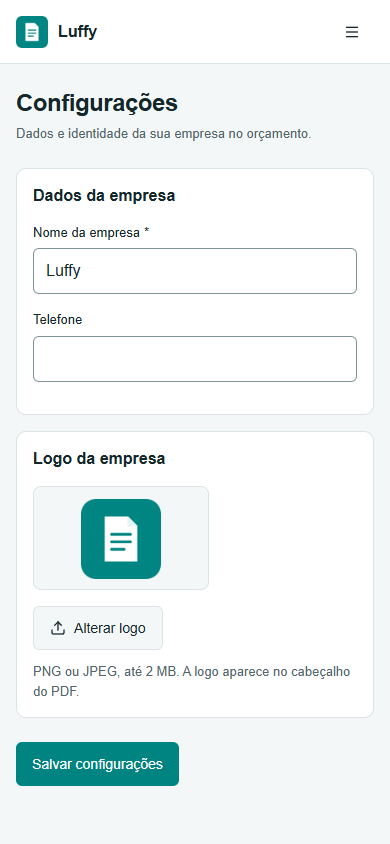
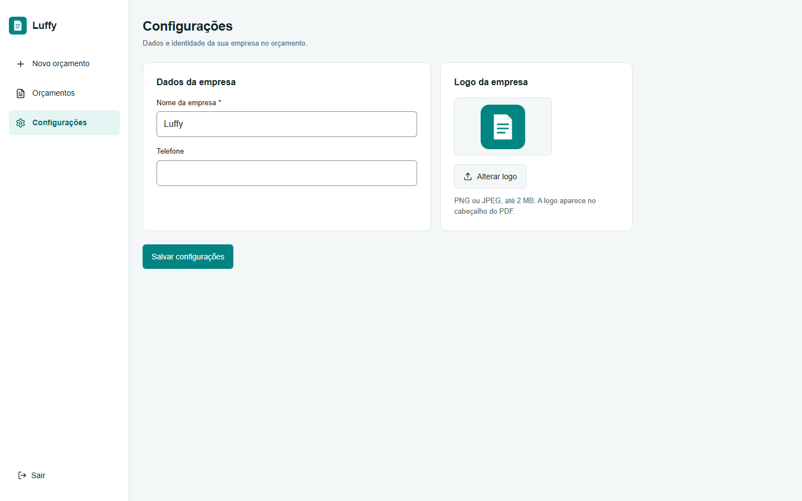

### Navegação

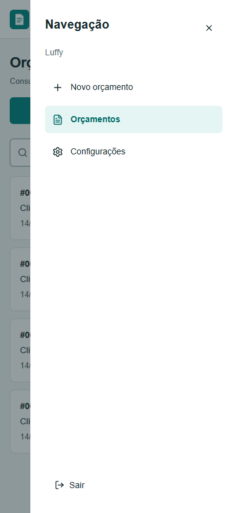


### Validação Zod

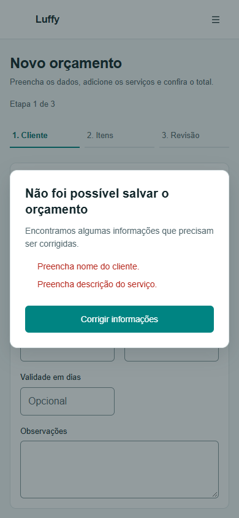
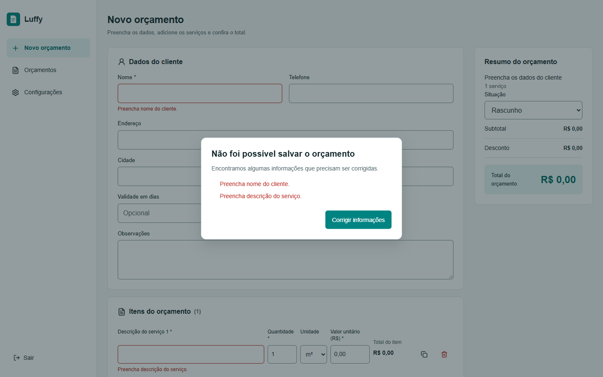

### Carregamento

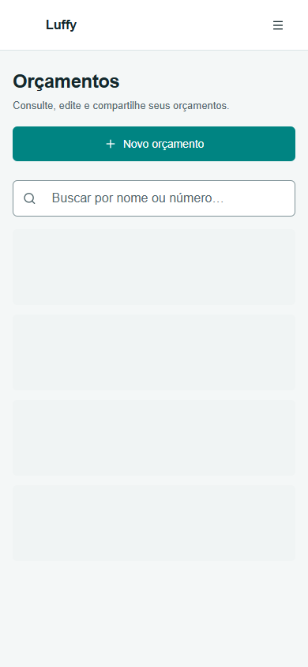
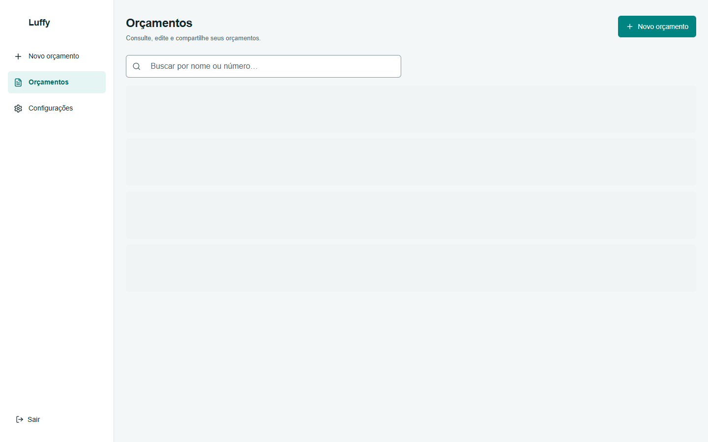
